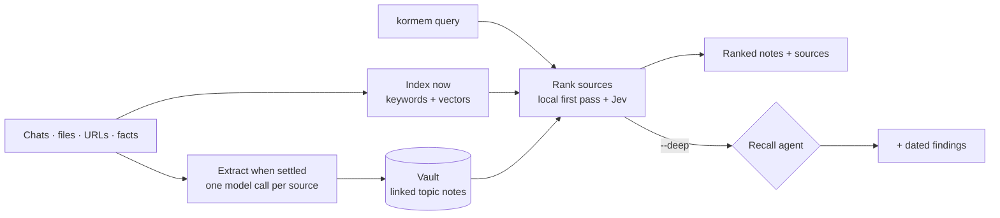
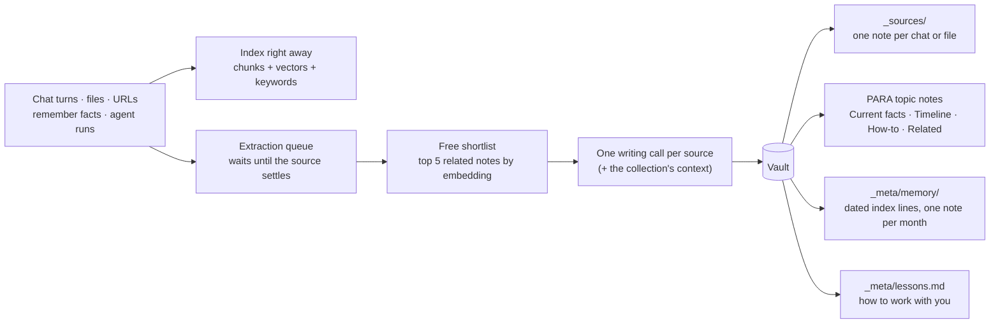
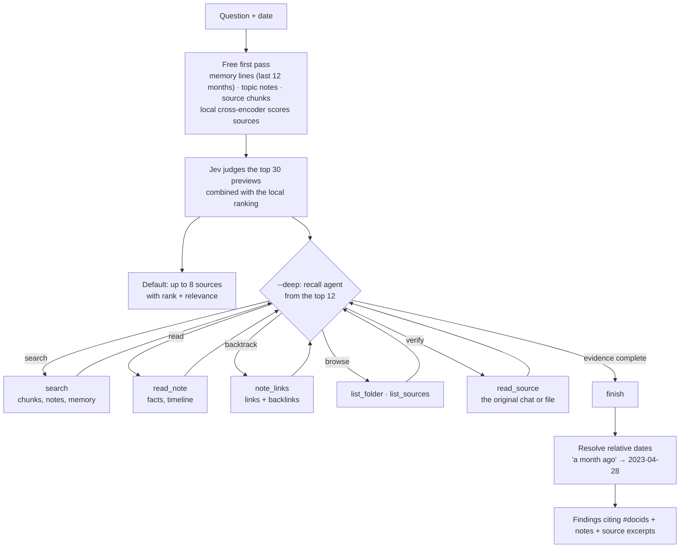
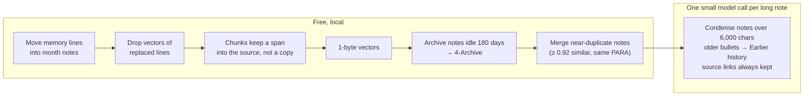
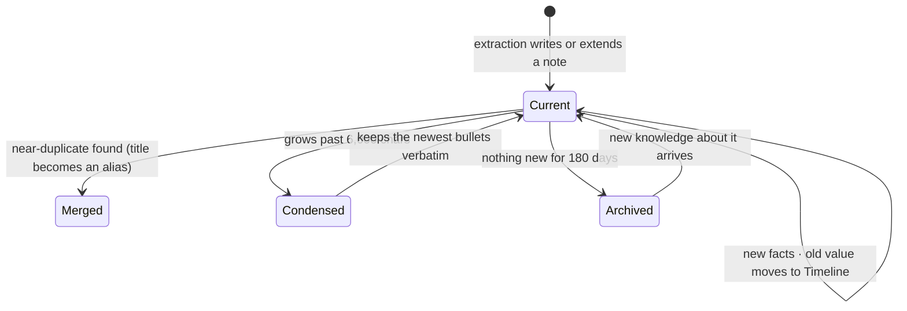

# kormem

[](LICENSE)
[](https://github.com/kushalsinha/kormem/actions/workflows/ci.yml)
[](CONTRIBUTING.md)
[](https://www.npmjs.com/package/kormem)
[](https://pypi.org/project/kormem/)

Local long-term memory for AI agents. kormem indexes everything you say to assistants and every file, folder or URL you add, then files it into an Obsidian-compatible vault of linked notes. When your agent needs something from the past, `kormem query` returns the notes and sources that answer it, ranked by relevance, in a few seconds. For counts, timelines and preferences, `--deep` sends a recall agent through the vault, and it comes back with dated findings.

If you know [QMD](https://github.com/tobi/qmd), you already know the commands: `collection add`, `context add`, `search`, `vsearch`, `query`, `get`, `multi-get` and `ls` work the same way. kormem adds the memory layer on top: chats, lessons, a linked vault and recall.

## Add kormem to your agent

Paste this into Claude Code, Codex, Cursor or any agent that can run commands:

```text
Install kormem, long-term memory for this agent. Run `npm install -g kormem` (or `pip install kormem`), then `kormem init`. In Claude Code, `kormem init` also installs the kormem plugin; if it says it didn't, run `claude plugin marketplace add kushalsinha/kormem`, then `claude plugin install kormem@kormem`. In another agent, run `npx skills add kushalsinha/kormem --skill kormem` and select your agent. Use one installation method. Then ask me to add my OPENAI_API_KEY, and optionally TYPESAFE_API_KEY, to ~/.kormem/.env; don't ask me to paste keys into the chat. You can read the skill at https://github.com/kushalsinha/kormem/blob/main/plugin/skills/kormem/SKILL.md (raw: https://raw.githubusercontent.com/kushalsinha/kormem/main/plugin/skills/kormem/SKILL.md). Then use kormem to recall what I've said, decided and preferred before.
```

In Claude Code, the plugin also remembers every session on its own and loads your lessons when the next one starts. Other agents recall through the skill and the `kormem` CLI, and can add the [MCP server](#mcp-server).



## Fast decisions with Jev

Most of what a memory system does is decide: is this source relevant to the question, which ones belong in the answer, which can be left out. Large models are good at these calls but slow and costly to make on every question, so kormem's recall gives them to [Jev](https://typesafe.ai), a decision model from TypeSafe. Jev answers a yes/no question about a small piece of text with a calibrated probability in about a tenth of a second, for $0.042 per million input tokens.

When your agent asks kormem something, a free local pass (embeddings, keyword search and a cross-encoder on your machine) finds the 30 most likely sources. Jev then reads a short preview of each, all in parallel, and judges whether it helps answer the question, even partly: one item of a count, an earlier value, a date, a stated preference. kormem combines Jev's ranking with the local one, keeps the strongest sources and leaves out the weak ones, and tells your agent each source's rank and relevance so it knows where to look first.

The Jev step takes about 0.3 seconds and costs about a tenth of a cent per question, and no LLM is called. The alternative is a recall agent that reads the sources itself: a little more thorough, but around 30 seconds and several model calls per question. kormem keeps that agent for the questions that need it (`--deep`). Without a `TYPESAFE_API_KEY`, kormem ranks with the local pass alone. [How we chose this design](docs/research/jev-decisions.md).

## Benchmark

[LongMemEval-S](https://arxiv.org/abs/2410.10813), all 500 questions, scored by the official GPT-4o judge (`evaluate_qa.py`) unless marked as Mem0's custom judge. Each question gets one answer from kormem's deep recall (linked vault and recall agent; about 8 full sessions, ~32k tokens of context). All Kormem rows answer from the same cached contexts.

| System | Answer model | Accuracy |
|---|---|---|
| **Kormem** | **Claude Sonnet 5.5 (Mem0's custom judge)** | **95.6%** |
| [Mastra Observational Memory](https://mastra.ai/research/observational-memory) | gpt-5-mini | 94.9% |
| **Kormem** | **Claude Sonnet 5.5** | **94.4%** |
| **Kormem** | **GPT-6.1 Sol** | **93.8%** |
| **Kormem** | **GPT-6 Astra** | **93.6%** |
| [Mem0 platform](https://github.com/mem0ai/memory-benchmarks) | GPT-5 (custom judge) | 93.4–94.4% |
| [gbrain](https://github.com/garrytan/gbrain) | Claude Sonnet 4.6 | 86.6% |
| [Supermemory](https://supermemory.ai/research/longmembench) | Gemini 3 Pro | 85.2% |
| [Zep](https://arxiv.org/abs/2501.13956) | GPT-4o | 71.2% |

Other systems' numbers are self-reported; see the [full report](docs/benchmarks/longmemeval.md) for setups and caveats. On identical context, Kormem ranges from 93.6% (Astra) to 94.4% (Sonnet 5.5); any of the three answers 481/500. Mem0's figure uses its own, more lenient judge. Re-judging our misses ([details](docs/benchmarks/longmemeval.md#under-mem0s-judge)) with that judge (same prompt, GPT-5) raises Kormem with Sonnet to **95.6%**, Sol and Astra to 94.4%.

MemPalace publishes only retrieval recall (R@5: a gold session in the top 5), not answer accuracy, so it gets its own table. Same 500 questions, session level:

| System | LLM in ranking | R@5 | All gold sessions in top 5 |
|---|---|---|---|
| **Kormem** | **yes** | **99.8%** | **95.8%** |
| [MemPalace](https://github.com/mempalace/mempalace) hybrid v4 + LLM rerank | yes | 99.2% | 89.8% |
| [MemPalace](https://github.com/mempalace/mempalace) hybrid v4 (held-out 450) | no | 98.4% | 88.7% |
| [MemPalace](https://github.com/mempalace/mempalace) raw | no | 96.6% | 85.0% |

MemPalace figures are recomputed from its committed per-question results; method in the [full report](docs/benchmarks/longmemeval.md#retrieval-recall).

## Quick start

```sh
# Install (Node or Bun)
npm install -g kormem
# or
bun install -g kormem

# Or run directly
npx kormem ...
bunx kormem ...

# Or from Python
pip install kormem          # or: uvx kormem ...

# Set up once: key file, engine, background services, Claude Code plugin
kormem init

# Index folders as collections (re-indexing later only touches changed files)
kormem collection add ~/notes --name notes
kormem collection add ~/work/docs --name docs --mask "**/*.md"

# Describe them. The context is returned with results and guides how notes get filed.
kormem context add kormem://notes "Personal notes and ideas"
kormem context add kormem://docs "Work documentation"

# Search
kormem search "project timeline"            # fast keyword search
kormem vsearch "how to deploy"              # semantic search
kormem query "what did we decide about X?"  # ranked notes and sources; --deep runs the recall agent

# Open what you found
kormem get "#abc123"                        # a source by docid (shown in results)
kormem get "kormem://notes/meeting.md:50:20"  # a file, from line 50, 20 lines
kormem get "Deploy process"                 # a vault note by title
kormem multi-get "notes/2026-05*"

# Memory
kormem remember "I prefer pnpm over npm"
kormem lessons                              # what you've told assistants about working with you
```

`kormem init` creates `~/.kormem/.env` (see [`.env.example`](.env.example)) and starts everything that can run:

- **Engine**: a local server that every command, the MCP server and the hooks talk to. Any command starts it if it isn't running.
- **Background worker**: indexes what you add and files it into the vault once a chat goes quiet or a file is read.
- **Maintenance**: merges, condenses and archives notes once a day.
- **Claude Code**: if `claude` is installed, the plugin (MCP server, session hooks, recall skill). Skip with `--skip-agents`.

The npm package is a small launcher. On first run it installs the matching `kormem` Python package into `~/.kormem/engine`, using [uv](https://docs.astral.sh/uv/) if you have it (it fetches Python for you), otherwise Python 3.11+ with pip. After that, a command starts in about 0.1 s.

### Models and keys

Kormem uses models for four jobs: **extraction** (filing what you add into the vault), **recall** (the agent behind `kormem query --deep`), **decisions** (Jev, which ranks the sources `query` returns) and **embeddings** (semantic search). The answer itself comes from your assistant's own model (Claude Code, Cursor, ...); kormem only finds the context.

| Setup | Keys in `~/.kormem/.env` | Extraction and recall | Embeddings |
|---|---|---|---|
| **Recommended** | `OPENAI_API_KEY` | `gpt-6-luna` | `text-embedding-3-small` |
| Gemini only | `GEMINI_API_KEY` | `gemini-3.8-flash` (works, costs more to run) | `gemini-embedding-2` |
| No key | none | off: nothing is filed into the vault and `query` returns ranked notes and sources without agent findings | local |

`TYPESAFE_API_KEY` adds [Jev](#fast-decisions-with-jev) (`jev-1.13.0`) to any setup. Jev sees short previews of the sources that match a question, so those previews are sent to TypeSafe; without the key, ranking stays on your machine.

One OpenAI key runs everything else: `gpt-6-luna` for extraction and the recall agent, and `text-embedding-3-small` for embeddings, which retrieves as well as `gemini-embedding-2` at a tenth of the price. To use Gemini embeddings instead, add `GEMINI_API_KEY` and run `kormem model set embedding gemini-embedding-2`. Every embedding option stores 768-d vectors, about 0.8 KB each, and kormem embeds only text.

```sh
kormem model                               # each job's model, its key, and this guidance
kormem model set llm gpt-6-luna            # extraction and recall together
kormem model set recall gemini-3.8-flash   # or one job; "default" undoes it
kormem model set embedding gemini-embedding-2     # or text-embedding-3-small, local; re-embeds the index (asks first)
kormem model set decision jev-1.13.0       # the Jev model; "default" undoes it
```

**Pick the embedding model once.** Vectors from different models can't be compared, so changing it (or adding `OPENAI_API_KEY` after indexing locally) drops every vector and re-embeds everything in the background. `kormem model set embedding` shows how many vectors that is and asks before it starts. Keyword search works throughout; `kormem status` shows how many chunks are still waiting.

Keys already set in your environment win over the file, and `KORMEM_EXTRACTION_MODEL` / `KORMEM_RECALL_MODEL` override `kormem model`. Add or remove a key, or change a model, and the next `kormem` command restarts the engine with the change. `kormem doctor` shows what is set.

### Claude Code

`kormem init` installs the plugin. It adds the MCP server, the session hooks (every session is remembered, and your lessons load at the start of the next one) and a skill that tells Claude when to recall. To install it yourself:

```sh
npm install -g kormem
claude plugin marketplace add kushalsinha/kormem
claude plugin install kormem@kormem
```

Or set it up by hand: see [docs/integrations/claude-code.md](docs/integrations/claude-code.md).

### Using with AI agents

`--json`, `--files` and `--md` are made for agents:

```sh
kormem query "what is the user's deploy process?" --md      # notes and ranked sources (+ findings with --deep) as markdown
kormem search "authentication" --json -n 10
kormem vsearch "error handling" --all --files --min-score 0.4
kormem get "#abc123" --full
```

### MCP server

```json
{
  "mcpServers": {
    "kormem": { "command": "kormem", "args": ["mcp"] }
  }
}
```

That goes in `~/.claude/settings.json` for Claude Code, `claude_desktop_config.json` for Claude Desktop, or your client's MCP settings.

| Tool | What it does |
|---|---|
| `query` | Recall: ranked sources (rank and relevance) and the topic notes they link to, with docids. `deep: true` runs the recall agent for counts, timelines and preferences and adds dated findings. QMD-style `searches` arrays are accepted. |
| `search` | Fast keyword or vector search over indexed chunks, no agent. |
| `get` | A note or source by `#docid`, `kormem://` address, title or path. `"#abc123:120:40"` reads a line range. |
| `multi_get` | Several notes or sources by glob or comma-separated list. |
| `status` | Index health, queues and collections. |
| `remember` | Store a fact, preference or decision. |
| `lessons` | How this user wants assistants to work with them. |
| `ingest` | Add a file, folder or URL. |

## Coming from QMD

| QMD | kormem | Same? |
|---|---|---|
| `qmd collection add <path> --name n --mask m` | `kormem collection add <path> --name n --mask m` | Same. `list`, `remove`, `rename`, `show` too. |
| `qmd context add qmd://notes "…"` | `kormem context add kormem://notes "…"` | Same, with `kormem://`. Also guides how notes are filed. |
| `qmd search` / `vsearch` | `kormem search` / `vsearch` | Same flags: `-n`, `-c`, `--all`, `--min-score`, `--full`, `--json`, `--files`, `--csv`, `--md`, `--xml`. |
| `qmd query` | `kormem query` | Same role. kormem's ranks sources with Jev; `--deep` runs a recall agent over the vault and returns findings with dates. |
| `qmd get`, `multi-get`, `ls` | `kormem get`, `multi-get`, `ls` | Same, including `#docid` and `path:from:count`. |
| `qmd embed [-f]`, `update`, `status`, `doctor`, `cleanup`, `mcp` | same names | Same. |
| — | `remember`, `lessons`, `hook`, `chat`, `extract`, `maintain`, `notes` | Memory commands, below. |

## Commands

### Collections and context

```sh
kormem collection add . --name myproject            # current folder
kormem collection add ~/notes --name notes --mask "**/*.md,journal/**/*.txt"
kormem collection list
kormem collection show notes
kormem collection rename notes journal
kormem collection remove journal                    # drops its sources; vault notes built from them stay
kormem update [name]                                # re-index: new, changed and deleted files only

kormem context add / "Knowledge base for my projects"      # applies to everything
kormem context add kormem://notes/work "Work notes"         # a folder inside a collection
cd ~/notes/journal && kormem context add "Daily journal"    # the folder you are in
kormem context list
kormem context rm kormem://notes/work
```

Supported files: Markdown, text, HTML, JSON, XML, PDF, DOCX and common source code. Hidden folders and `node_modules` are skipped.

### Search and retrieval

```sh
kormem search "blue-green deploy"          # keywords; plural and tense forms match ("rollback" finds "rollbacks")
kormem vsearch "how do we roll back"       # meaning
kormem query "who approves production deploys?"          # ranked notes and sources
kormem query "how many times did we change the API key?" --deep   # recall agent, dated findings
kormem query "…" --date 2026-03-01         # answer as of a date
kormem query "…" --full                    # include note bodies and source text

kormem get "#abc123"                       # lines are numbered; --no-line-numbers to turn off
kormem get "#abc123" -l 40 --from 120
kormem multi-get "#abc123, #def456, Deploy process"
kormem multi-get "kormem://notes/meetings/2026-0*" --max-bytes 20480 --json
kormem ls                                  # collections and vault folders
kormem ls notes/meetings
kormem ls vault/2-Areas
```

Search options: `-n <num>` (default 5, or 20 with `--json` / `--files`), `-c <collection>`, `--all`, `--min-score <n>`, `--full`, `--no-rerank`. Output: `--format cli|json|csv|md|xml|files`, or the short forms `--json`, `--csv`, `--md`, `--xml`, `--files`.

Addresses work everywhere a ref is taken:

- `#abc123`: any source (chat, file, URL, remembered fact) by docid
- `kormem://notes/path/file.md`: a file in a collection
- `kormem://vault/2-Areas/Health/Running.md`, or just `Running`: a vault note (titles and aliases work)

### Memory

```sh
kormem remember "Always run the linter before committing"
kormem remember --content "Prefers metric units" --role user
kormem lessons [--project kormem]          # global lessons plus a project's
kormem ingest https://example.com/post     # one file, folder or URL, without a collection
kormem chat append --session S1 --role user --content "..."   # feed a chat from any agent
kormem chat close --session S1
kormem extract                             # how many sources wait for extraction
kormem extract --wait                      # file them into the vault now
kormem notes ls --para areas
kormem notes links "Deploy process"        # outbound links and backlinks
```

### Maintenance

```sh
kormem status                  # sources, chunks, queues, collections, embedding provider
kormem doctor                  # install, keys, engine
kormem model [set <job> <model>] # models for extraction, recall, decisions and embeddings
kormem embed [-f]              # embed what's waiting now; -f re-embeds everything
kormem cleanup [--vacuum]      # compact the index, no model calls
kormem maintain [--vacuum]     # cleanup + archive, merge and condense notes (runs daily by itself)
kormem stop                    # stop the background engine (the next command restarts it)
```

## How it works

kormem runs a local engine in the background. The first command starts it, and every command, the MCP server and the Claude Code hooks talk to it. It keeps the index, runs extraction when sources settle, and tidies memory once a day.

### How memory flows

Everything is searchable the moment it arrives. The paid step, extraction, waits until a source has settled: a file once it's read, a chat after 30 minutes idle, at session end, or every 40 turns.



Topic notes keep what the user said apart from what the assistant suggested, and every bullet links back to its source note. When a fact changes, the new value goes into Current facts. The old value moves to the Timeline, and its memory line is marked replaced.

### How recall thinks

Recall has two modes. Both start the same way: a free local pass scores memory lines, topic notes and source chunks, a local cross-encoder scores the candidate sources, and Jev judges the top 30.

- **Default** (`kormem query`, MCP `query`): the best sources, up to 8, in date order, each labelled with its rank and Jev's relevance. Below the top 5, a source stays only if Jev thinks it helps. This is what your agent gets on every question.
- **Deep** (`--deep`, MCP `deep: true`): a small agent starts from the top 12 and reads, follows links and opens sources until the evidence is complete, then returns dated findings with the sources. It suits counts, timelines and "what do I prefer" questions. A simple lookup that one source clearly answers skips the agent.



A counting question becomes "read the note's Timeline, then check each linked source". Archived notes join only when fewer than two current notes match.

### How memory stays small

A maintenance pass runs once a day while the engine is idle, or on demand with `kormem maintain`. Everything except condensing is free.





On a copy of 60 LongMemEval users, a maintenance pass cut the index from 403 MB to 186 MB in about 10 seconds. Condensing costs about $0.008 per user.

## Data storage

```
~/.kormem/
├── .env                 # API keys (kormem init creates it)
├── config.yaml          # collections, contexts, models
├── index.sqlite         # sources, chunks, vectors, keyword index, chat turns, queues
├── vault/<namespace>/   # the Obsidian-compatible vault (open it in Obsidian)
│   ├── _sources/        # one note per chat, file or URL
│   ├── 1-Projects/ 2-Areas/ 3-Resources/ 4-Archive/
│   └── _meta/           # memory index by month, lessons, folder registry, map of content
├── engine/              # the Python engine the npm launcher installed
└── logs/engine.log
```

## Environment variables

| Variable | Default | Description |
|---|---|---|
| `KORMEM_HOME` | `~/.kormem` | Data directory |
| `KORMEM_NAMESPACE` | `main` | Memory namespace; or `--namespace` on any command |
| `OPENAI_API_KEY` | unset | Extraction and the recall agent (`gpt-6-luna`) and embeddings (`text-embedding-3-small`, 768-d); the one key you need |
| `GEMINI_API_KEY` | unset | Optional. Embeddings (`gemini-embedding-2`), extraction and recall when it is the only key |
| `TYPESAFE_API_KEY` | unset | Optional. Jev ranks the sources `query` returns; short source previews are sent to TypeSafe |
| `KORMEM_DECISION_MODEL` | `jev-1.13.0` | Override the Jev model |
| `KORMEM_EMBEDDING_PROVIDER` | `auto` | `auto` (OpenAI, then Gemini, by which key is set), `openai`, `gemini` or `local`; prefer `kormem model set embedding` |
| `KORMEM_EXTRACTION_MODEL` / `KORMEM_RECALL_MODEL` | from `kormem model` | Override the extraction or recall model (`KORMEM_QUERY_MODEL` is an older name for recall) |
| `FIRECRAWL_API_KEY` | unset | Page text for URL ingest |
| `KORMEM_ENV_FILE` | `~/.kormem/.env` | Where keys and settings are read from |
| `KORMEM_ENGINE_PORT` / `KORMEM_ENGINE_URL` | `8787` | Where the engine listens |
| `KORMEM_LOCAL_EMBED_MODEL` | `BAAI/bge-base-en-v1.5` | Local embeddings when no Gemini key is set |
| `KORMEM_CHAT_IDLE_MINUTES` / `KORMEM_CHAT_MAX_TURNS` | `30` / `40` | When a chat counts as settled for extraction |
| `KORMEM_MAINTAIN_HOURS` | `24` | Hours between maintenance passes (`0` = only on request) |
| `KORMEM_ARCHIVE_DAYS` | `180` | Idle days before a note moves to `4-Archive` |
| `KORMEM_MERGE_SIMILARITY` | `0.92` | Similarity needed to merge two notes |
| `KORMEM_NOTE_MAX_CHARS` | `6000` | Note size that triggers condensing |
| `KORMEM_MEMORY_SCAN_MONTHS` | `12` | Months of memory lines recall scores (`0` = all) |
| `KORMEM_LESSONS_MAX_CHARS` | `8000` | Lessons loaded at session start |
| `KORMEM_DROP_VECTORS_AFTER_DAYS` | `0` (off) | Drop vectors of older chunks; keyword search still finds them |
| `KORMEM_PYTHON` | unset | npm launcher: use this Python (with `kormem` installed) instead of the managed one |
| `KORMEM_ENGINE_SPEC` | `kormem==<version>` | npm launcher: what to install (a version, wheel or git URL) |
| `KORMEM_DEBUG` | unset | Print hook errors instead of dropping them |

## Development

```sh
cd packages/engine && pip install -e ".[dev]" && pytest tests -q   # engine + CLI (Python)
cd packages/cli && npm install && npx tsc                            # npm launcher and JS SDK
node packages/cli/dist/kormem.js status                              # a checkout runs the engine from source
scripts/release.sh --dry-run                                         # build and check both packages
```

The `kormem` npm package also exports a small JS SDK (`createMemoryStore`) that talks to the engine over HTTP. See [docs/integrations/](docs/integrations/) for Claude Code and OpenClaw.

## Contributing

Bug reports, docs fixes and pull requests are welcome. Read [CONTRIBUTING.md](CONTRIBUTING.md) for how to set up a development environment and what a good pull request looks like. Everyone taking part is expected to follow the [Code of Conduct](CODE_OF_CONDUCT.md). Changes are tracked in the [changelog](CHANGELOG.md).

## Security

Please report vulnerabilities privately, not in a public issue. See [SECURITY.md](SECURITY.md).

## License

MIT
