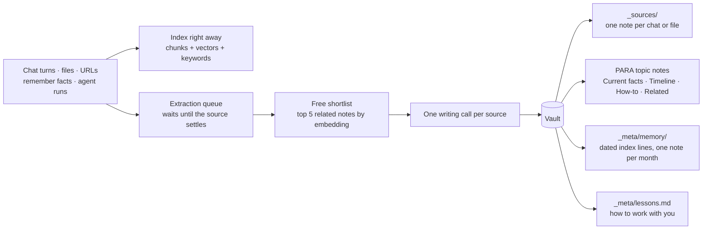
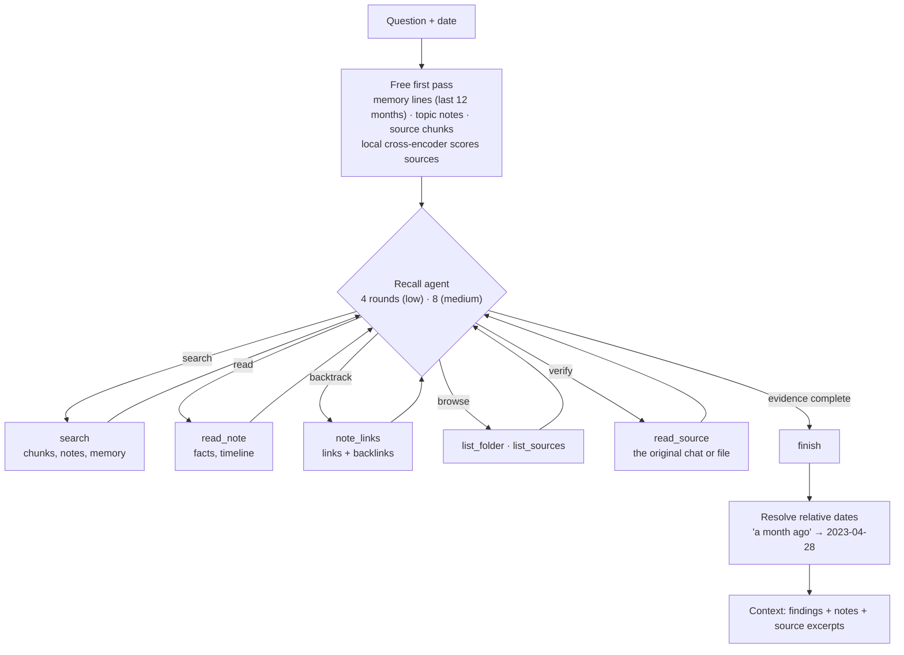
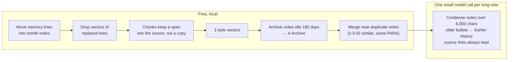
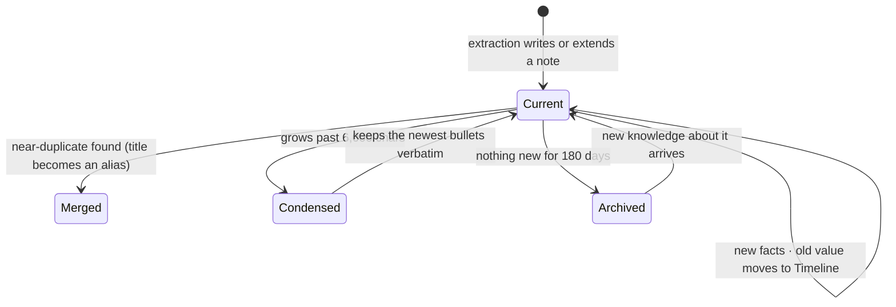

# Kormem

Local-first memory for deep agents — index, vectorize, and retrieve everything a user says and every document they add. Built for CLI agents (Claude Code, OpenClaw) with a [QMD](https://github.com/tobi/qmd)-style install.

**Default data directory:** `~/.kormem` (override with `KORMEM_HOME`)

## Install

```bash
npm install -g @kormem/kormem
# or
bun install -g @kormem/kormem

# Python engine (dev / from source)
cd packages/engine && pip install -e ".[dev]"
```

## Quick start

```bash
kormem init
kormem ingest ~/notes --collection notes          # files, folders or URLs
kormem remember "I prefer concise answers" --role user
kormem query "what did we decide about the deploy process?"
kormem mcp
```

Everything you add is indexed immediately and extracted in the background into an Obsidian-compatible vault at `~/.kormem/vault/<namespace>/`: a note per source in `_sources/`, linked topic notes in PARA folders (`1-Projects`, `2-Areas`, `3-Resources`, `4-Archive`) with current facts, a dated timeline and how-tos, plus a dated memory index filed by month in `_meta/memory/` and `_meta/lessons.md` (what you told the assistant to remember about working with you). `kormem query` runs a recall agent that walks those links and returns dated findings with their sources.

Memory stays small as it grows. Text is stored once (chunks point into their chat or document), vectors are 1-byte, replaced facts drop out of the memory index while the note's timeline keeps them, and a daily `kormem maintain` pass archives notes untouched for 180 days, merges near-duplicate notes and condenses very long ones (source links are always kept, so recall can go back to the original chat).

For Claude Code, add `kormem hook` to `SessionStart`, `Stop` and `SessionEnd`: every session is remembered and your lessons load at the start of the next one; see [docs/integrations/claude-code.md](docs/integrations/claude-code.md).

## Embeddings

Default: **`gemini-embedding-2` at 768 dimensions** when `GEMINI_API_KEY` is set.

Without an API key, kormem falls back to a **local ONNX model** via fastembed (`BAAI/bge-base-en-v1.5`, cached under `~/.kormem/models/`) — similar to [QMD's local GGUF models](https://github.com/tobi/qmd#gguf-models-via-node-llama-cpp).

```bash
export GEMINI_API_KEY=your_key   # optional; enables cloud embeddings
kormem doctor                    # shows active provider + dimension warnings
kormem embed -f                  # force re-embed after provider change
```

## Benchmark

LongMemEval-S, all 500 questions, scored by the official GPT-4o judge (`evaluate_qa.py`). Each question gets one answer from a curated context of about 19k tokens.

| System | Answer model | Accuracy |
|---|---|---|
| Mastra Observational Memory | gpt-5-mini | 94.9% |
| **Kormem** | **Claude Sonnet 5.5** | **94.4%** |
| **Kormem** | **GPT-6.1 Sol** | **94.0%** |
| Mem0 platform | GPT-5 (custom judge) | 93.4–94.4% |
| gbrain | Claude Sonnet 4.6 | 86.6% |
| Supermemory | Gemini 3 Pro | 85.2% |
| Zep | GPT-4o | 71.2% |

Other systems' numbers are self-reported; see the [full report](docs/benchmarks/longmemeval.md) for setups and caveats. The answer model accounts for much of the spread: on identical context, Kormem ranges from 88.0% (Grok 4.7) to 94.4% (Sonnet 5.5).

## Architecture

- **CLI / MCP / SDK** — TypeScript (`@kormem/kormem`)
- **Memory engine** — Python (`kormem-engine`): chunking, embeddings, SQLite store, hybrid search, chat sessions, background extraction into the vault, recall agent, web + file connectors

### How memory flows

Everything is searchable the moment it arrives. The paid step, extraction, waits until a source has settled: a file once it's read, a chat after 30 minutes idle, at session end, or every 40 turns.



Topic notes keep what the user said apart from what the assistant suggested, and every bullet links back to its source note. When a fact changes, the new value goes into Current facts. The old value moves to the Timeline, and its memory line is marked replaced.

### How recall thinks

`kormem query` and the MCP `recall` tool always run a small agent over the vault. It starts from a free first pass, then reads, follows links and opens sources until the evidence is complete.



A counting question becomes "read the note's Timeline, then check each linked source". Archived notes join only when fewer than two current notes match.

### How memory stays small

A maintenance pass runs once a day while the server is idle, or on demand with `kormem maintain`. Everything except condensing is free.





On a copy of 60 benchmark users, a maintenance pass cut the index from 403 MB to 186 MB in about 10 seconds. Condensing costs about $0.008 per user. The settings are in [docs/integrations/claude-code.md](docs/integrations/claude-code.md#keeping-memory-small).

## MCP (Claude Code)

```json
{
  "mcpServers": {
    "kormem": {
      "command": "kormem",
      "args": ["mcp"]
    }
  }
}
```

## Development

```bash
# Engine
cd packages/engine && pytest tests/ -v
python -m kormem serve

# CLI
cd packages/cli && bun install && bun run build
```

See [docs/integrations/](docs/integrations/) for OpenClaw and Claude Code setup.
